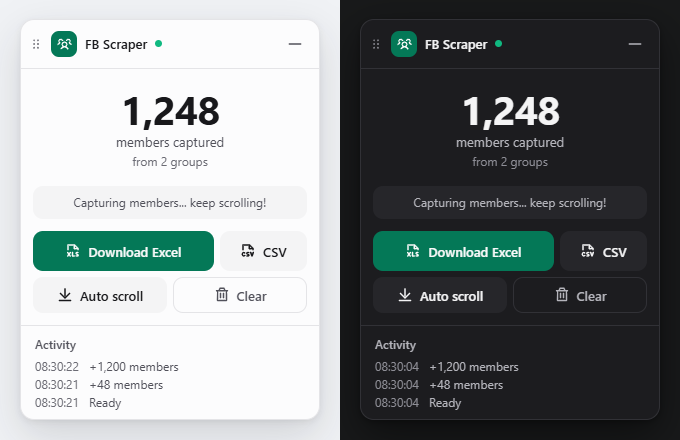

# Facebook Group Members Scraper

Free, open-source script that collects the members of a Facebook group and exports them to a CSV file. It runs entirely in your browser: no extension, no account, no server, no proxy. Copy-paste the script into the browser console and a small control panel appears.



## How to use it

1. Open the Facebook group page.
1. Open the browser Developer Console (`Ctrl + Shift + I` on Windows/Linux, `Cmd + Option + I` on Mac) and select the **Console** tab.
1. Paste the script below and press Enter. The **FB Scraper** panel appears in the bottom-right corner. **Paste the script before opening the "People"/"Members" tab.**
1. Open the group's **People** tab. The green dot lights up and the counter goes up as members are captured.
1. Scroll down to load more members, or click **Auto Scroll** and let the panel scroll for you. Click **Stop Scroll** when you have enough.
1. Click **Download CSV** to save the file.
1. Captured profiles stay in your browser's cache until you click **Reset**, so they survive a page reload or a browser crash.

> [dist/main.min.js](dist/main.min.js)

```javascript
var q=Object.defineProperty,Z=(t,e,n)=>e in t?q(t,e,{enumerable:!0,configurable:!0,writable:!0,value:n}):t[e]=n,m=(t,e,n)=>Z(t,"symbol"!=typeof e?e+"":e,n);function G(t,e){for(var n="",i=0;i<e.length;i++)n+=(t=>{for(var e="",n=0;n<t.length;n++){var i=null===t[n]||"u"<typeof t[n]?"":t[n].toString(),i=(i=t[n]instanceof Date?t[n].toLocaleString():i).replace(/"/g,'""');0<n&&(e+=","),e+=i=0<=i.search(/("|,|\n)/g)?'"'+i+'"':i}return e+`
`})(e[i]);var r=new Blob([n],{type:"text/csv;charset=utf-8;"}),o=document.createElement("a");void 0!==o.download&&(r=URL.createObjectURL(r),o.setAttribute("href",r),o.setAttribute("download",t),document.body.appendChild(o),o.click(),document.body.removeChild(o))}let C=(e,t)=>t.some(t=>e instanceof t),A,N;function Q(){return A=A||[IDBIndex,IDBObjectStore,IDBCursor,IDBDatabase,IDBTransaction]}function tt(){return N=N||["advance","continue","continuePrimaryKey"].map(t=>IDBCursor.prototype[t])}let S=new WeakMap,B=new WeakMap,y=new WeakMap;function et(o){var t=new Promise((t,e)=>{let n=()=>{o.removeEventListener("success",i),o.removeEventListener("error",r)},i=()=>{t(b(o.result)),n()},r=()=>{e(o.error),n()};o.addEventListener("success",i),o.addEventListener("error",r)});return y.set(t,o),t}function nt(o){var t;S.has(o)||(t=new Promise((t,e)=>{let n=()=>{o.removeEventListener("complete",i),o.removeEventListener("error",r),o.removeEventListener("abort",r)},i=()=>{t(),n()},r=()=>{e(o.error||new DOMException("AbortError","AbortError")),n()};o.addEventListener("complete",i),o.addEventListener("error",r),o.addEventListener("abort",r)}),S.set(o,t))}let D={get(t,e,n){if(t instanceof IDBTransaction){if("done"===e)return S.get(t);if("store"===e)return n.objectStoreNames[1]?void 0:n.objectStore(n.objectStoreNames[0])}return b(t[e])},set(t,e,n){return t[e]=n,!0},has(t,e){return t instanceof IDBTransaction&&("done"===e||"store"===e)||e in t}};function W(t){D=t(D)}function it(e){return tt().includes(e)?function(...t){return e.apply(I(this),t),b(this.request)}:function(...t){return b(e.apply(I(this),t))}}function ot(t){return"function"==typeof t?it(t):(t instanceof IDBTransaction&&nt(t),C(t,Q())?new Proxy(t,D):t)}function b(t){var e;return t instanceof IDBRequest?et(t):B.has(t)?B.get(t):(e=ot(t),Object.is(e,t)||(B.set(t,e),y.set(e,t)),e)}let I=t=>y.get(t);function rt(t,e,{blocked:n,upgrade:i,blocking:r,terminated:o}={}){let s=indexedDB.open(t,e),a=b(s);return i&&s.addEventListener("upgradeneeded",t=>{i(b(s.result),t.oldVersion,t.newVersion,b(s.transaction),t)}),n&&s.addEventListener("blocked",t=>n(t.oldVersion,t.newVersion,t)),a.then(t=>{o&&t.addEventListener("close",()=>o()),r&&t.addEventListener("versionchange",t=>r(t.oldVersion,t.newVersion,t))}).catch(()=>{}),a}let st=["get","getKey","getAll","getAllKeys","count"],at=["put","add","delete","clear"],k={};function P(t,e){if(t instanceof IDBDatabase&&!(e in t)&&"string"==typeof e){if(k[e])return k[e];let i=e.replace(/FromIndex$/,""),r=e!==i,o=at.includes(i);return i in(r?IDBIndex:IDBObjectStore).prototype&&(o||st.includes(i))?k[e]=async function(t,...e){t=this.transaction(t,o?"readwrite":"readonly");let n=t.store;return r&&(n=n.index(e.shift())),(await Promise.all([n[i](...e),o&&t.done]))[0]}:void 0}}W(i=>({...i,get:(t,e,n)=>P(t,e)||i.get(t,e,n),has:(t,e)=>!!P(t,e)||i.has(t,e)}));let ct=["advance","continue","continuePrimaryKey"],j={},L=new WeakMap,$=new WeakMap,lt={get(t,e){if(!ct.includes(e))return t[e];let n=j[e];return n=n||(j[e]=function(...t){L.set(this,$.get(this)[e](...t))})}};async function*dt(...t){let e=this;if(e=e instanceof IDBCursor?e:await e.openCursor(...t)){e=e;var n=new Proxy(e,lt);for($.set(n,e),y.set(n,I(e));e;)yield n,e=await(L.get(n)||e.continue()),L.delete(n)}}function F(t,e){return e===Symbol.asyncIterator&&C(t,[IDBIndex,IDBObjectStore,IDBCursor])||"iterate"===e&&C(t,[IDBIndex,IDBObjectStore])}W(i=>({...i,get(t,e,n){return F(t,e)?dt:i.get(t,e,n)},has(t,e){return F(t,e)||i.has(t,e)}}));var V,f=function(t,s,a,l){return new(a=a||Promise)(function(n,e){function i(t){try{o(l.next(t))}catch(t){e(t)}}function r(t){try{o(l.throw(t))}catch(t){e(t)}}function o(t){var e;t.done?n(t.value):((e=t.value)instanceof a?e:new a(function(t){t(e)})).then(i,r)}o((l=l.apply(t,s||[])).next())})},pt=function(t,e){var n={};for(r in t)Object.prototype.hasOwnProperty.call(t,r)&&e.indexOf(r)<0&&(n[r]=t[r]);if(null!=t&&"function"==typeof Object.getOwnPropertySymbols)for(var i=0,r=Object.getOwnPropertySymbols(t);i<r.length;i++)e.indexOf(r[i])<0&&Object.prototype.propertyIsEnumerable.call(t,r[i])&&(n[r[i]]=t[r[i]]);return n};class mt{constructor(t){this.name="scrape-storage",this.persistent=!0,this.data=new Map,null!=t&&t.name&&(this.name=t.name),null!=t&&t.persistent&&(this.persistent=t.persistent),this.initDB().then(()=>{}).catch(()=>{this.persistent=!1})}get storageKey(){return"storage-"+this.name}initDB(){return f(this,void 0,void 0,function*(){this.db=yield rt(this.storageKey,6,{upgrade(t,e,n,i){let r;if(e<5)try{t.deleteObjectStore("data")}catch{}(r=t.objectStoreNames.contains("data")?i.objectStore("data"):t.createObjectStore("data",{keyPath:"_id",autoIncrement:!0}))&&!r.indexNames.contains("_createdAt")&&r.createIndex("_createdAt","_createdAt"),r&&!r.indexNames.contains("_groupId")&&r.createIndex("_groupId","_groupId"),r&&!r.indexNames.contains("_pk")&&r.createIndex("_pk","_pk",{unique:!0})}})})}_dbGetElem(t,e){return f(this,void 0,void 0,function*(){if(this.persistent&&this.db)return yield(e=e||this.db.transaction("data","readonly")).store.index("_pk").get(t);throw new Error("DB doesnt exist")})}getElem(t){return f(this,void 0,void 0,function*(){if(this.persistent&&this.db)try{return yield this._dbGetElem(t)}catch(t){console.error(t)}else this.data.get(t)})}_dbSetElem(i,r,o=!1,s,a){return f(this,void 0,void 0,function*(){if(this.persistent&&this.db){let t=!1;var e=(a=a||this.db.transaction("data","readwrite")).store,n=yield e.index("_pk").get(i);return n?o&&(yield e.put(Object.assign(Object.assign({},n),r)),t=!0):(n=Object.assign({_pk:i,_createdAt:new Date},r),s&&(n._groupId=s),yield e.put(n),t=!0),t}throw new Error("DB doesnt exist")})}addElem(t,e,n=!1,i){return f(this,void 0,void 0,function*(){if(this.persistent&&this.db)try{return yield this._dbSetElem(t,e,n,i)}catch(t){console.error(t)}else this.data.set(t,e);return!0})}addElems(e,o=!1,s){return f(this,void 0,void 0,function*(){if(this.persistent&&this.db){let n=[],i=this.db.transaction("data","readwrite"),r=[];if(e.forEach(([t,e])=>{-1===r.indexOf(t)&&(r.push(t),n.push(this._dbSetElem(t,e,o,s,i)))}),0<n.length){n.push(i.done);var t=yield Promise.all(n);let e=0;return t.forEach(t=>{"boolean"==typeof t&&t&&(e+=1)}),e}return 0}return e.forEach(([t,e])=>{this.addElem(t,e)}),e.length})}deleteFromGroupId(n){return f(this,void 0,void 0,function*(){if(this.persistent&&this.db){let t=0,e=yield this.db.transaction("data","readwrite").store.index("_groupId").openCursor(IDBKeyRange.only(n));for(;e;)e.delete(),e=yield e.continue(),t+=1;return t}throw new Error("Not Implemented Error")})}clear(){return f(this,void 0,void 0,function*(){this.persistent&&this.db?yield this.db.clear("data"):this.data.clear()})}getCount(){return f(this,void 0,void 0,function*(){return this.persistent&&this.db?yield this.db.count("data"):this.data.size})}getAll(){return f(this,void 0,void 0,function*(){if(this.persistent&&this.db){let n=new Map,t=yield this.db.getAll("data");return t&&t.forEach(t=>{var e=t._id,t=pt(t,["_id"]);n.set(e,t)}),n}return this.data})}toCsvData(){return f(this,void 0,void 0,function*(){let e=[];return e.push(this.headers),(yield this.getAll()).forEach(t=>{try{e.push(this.itemToRow(t))}catch(t){console.error(t)}}),e})}}(t=>{t.ADD="add",t.LOG="log"})(V=V||{});class ut extends mt{constructor(){super(...arguments),m(this,"name","fb-scrape-storage")}get headers(){return["Profile Id","Full Name","Profile Link","Bio","ImageSrc","GroupId","Group Joining Text","Profile Type"]}itemToRow(t){return[t.profileId,t.fullName,t.profileLink,t.bio,t.imageSrc,t.groupId,t.groupJoiningText,t.profileType]}}let h=new ut;async function K(t=5e3){for(var e=Date.now();h.persistent&&!h.db&&Date.now()-e<t;)await new Promise(t=>setTimeout(t,50))}let ft=`
@keyframes fbs-slide-in {
    from { opacity: 0; transform: translateY(20px); }
    to   { opacity: 1; transform: translateY(0); }
}
@keyframes fbs-pulse-ring {
    0%   { box-shadow: 0 8px 32px rgba(0,0,0,.4), 0 0 0 0 rgba(24,119,242,.35); }
    70%  { box-shadow: 0 8px 32px rgba(0,0,0,.4), 0 0 0 8px rgba(24,119,242,0); }
    100% { box-shadow: 0 8px 32px rgba(0,0,0,.4), 0 0 0 0 rgba(24,119,242,0); }
}
@keyframes fbs-dot-blink {
    0%,100% { opacity: 1; }
    50%     { opacity: .35; }
}

/* ── Panel ── */
.fbs-panel {
    position: fixed !important;
    bottom: 24px !important;
    right: 24px !important;
    width: 300px !important;
    z-index: 99999 !important;
    font-family: -apple-system, BlinkMacSystemFont, 'Segoe UI', Roboto, Helvetica, Arial, sans-serif !important;
    background: linear-gradient(145deg, rgba(22,24,32,.97), rgba(28,31,40,.97)) !important;
    border: 1px solid rgba(255,255,255,.06) !important;
    border-radius: 16px !important;
    box-shadow: 0 8px 32px rgba(0,0,0,.4) !important;
    backdrop-filter: blur(20px) !important;
    -webkit-backdrop-filter: blur(20px) !important;
    color: #e4e6eb !important;
    overflow: hidden !important;
    box-sizing: border-box !important;
    line-height: 1.4 !important;
    font-size: 14px !important;
    animation: fbs-slide-in .3s ease-out !important;
}
.fbs-panel *, .fbs-panel *::before, .fbs-panel *::after {
    box-sizing: border-box !important;
    margin: 0 !important;
    padding: 0 !important;
}
.fbs-panel.fbs-pulse {
    animation: fbs-pulse-ring .55s ease-out !important;
}

/* ── Header ── */
.fbs-header {
    display: flex !important;
    align-items: center !important;
    gap: 8px !important;
    padding: 10px 12px !important;
    background: rgba(255,255,255,.025) !important;
    border-bottom: 1px solid rgba(255,255,255,.06) !important;
    cursor: move !important;
    user-select: none !important;
    -webkit-user-select: none !important;
}
.fbs-drag-icon {
    color: rgba(255,255,255,.25) !important;
    display: flex !important;
    align-items: center !important;
    flex-shrink: 0 !important;
}
.fbs-title {
    font-size: 13px !important;
    font-weight: 600 !important;
    color: #e4e6eb !important;
    flex-shrink: 0 !important;
}
.fbs-status-dot {
    width: 6px !important;
    height: 6px !important;
    border-radius: 50% !important;
    background: rgba(255,255,255,.18) !important;
    flex-shrink: 0 !important;
    transition: background .3s !important;
}
.fbs-status-dot.fbs-dot-active {
    background: #22c55e !important;
    animation: fbs-dot-blink 1s ease infinite !important;
}
.fbs-header-badge {
    font-size: 11px !important;
    font-weight: 600 !important;
    background: rgba(24,119,242,.12) !important;
    color: #6eaaff !important;
    padding: 2px 8px !important;
    border-radius: 10px !important;
    margin-left: auto !important;
    flex-shrink: 0 !important;
    line-height: 1.5 !important;
}
.fbs-header-right {
    display: flex !important;
    gap: 2px !important;
    flex-shrink: 0 !important;
    margin-left: 6px !important;
}
.fbs-icon-btn {
    background: none !important;
    border: none !important;
    color: rgba(255,255,255,.35) !important;
    cursor: pointer !important;
    padding: 4px !important;
    border-radius: 6px !important;
    display: flex !important;
    align-items: center !important;
    justify-content: center !important;
    transition: all .15s !important;
    line-height: 1 !important;
}
.fbs-icon-btn:hover {
    background: rgba(255,255,255,.08) !important;
    color: #e4e6eb !important;
}

/* ── Body ── */
.fbs-body {
    overflow: hidden !important;
}

/* ── Stats ── */
.fbs-stats {
    padding: 18px 16px 6px !important;
    text-align: center !important;
}
.fbs-counter {
    font-size: 36px !important;
    font-weight: 700 !important;
    color: #e4e6eb !important;
    display: block !important;
    letter-spacing: -1px !important;
    line-height: 1.1 !important;
}
.fbs-counter-label {
    font-size: 11px !important;
    color: rgba(255,255,255,.4) !important;
    text-transform: uppercase !important;
    letter-spacing: 1px !important;
    margin-top: 2px !important;
}
.fbs-group-count {
    font-size: 12px !important;
    color: rgba(255,255,255,.3) !important;
    display: block !important;
    margin-top: 4px !important;
}

/* ── Status hint ── */
.fbs-status {
    text-align: center !important;
    font-size: 11px !important;
    color: rgba(255,255,255,.35) !important;
    padding: 4px 16px 14px !important;
    font-style: italic !important;
    line-height: 1.4 !important;
}

/* ── Actions ── */
.fbs-actions {
    padding: 0 12px 12px !important;
    display: flex !important;
    flex-direction: column !important;
    gap: 6px !important;
}
.fbs-btn {
    border: none !important;
    border-radius: 8px !important;
    padding: 9px 14px !important;
    font-size: 13px !important;
    font-weight: 500 !important;
    cursor: pointer !important;
    transition: all .15s ease !important;
    display: flex !important;
    align-items: center !important;
    justify-content: center !important;
    gap: 6px !important;
    font-family: inherit !important;
    white-space: nowrap !important;
    line-height: 1.2 !important;
    text-decoration: none !important;
    outline: none !important;
}
.fbs-btn svg { flex-shrink: 0 !important; }

.fbs-btn-primary {
    background: #1877F2 !important;
    color: #fff !important;
}
.fbs-btn-primary:hover {
    background: #1565d8 !important;
}

.fbs-btn-secondary {
    background: rgba(255,255,255,.06) !important;
    color: #b0b3b8 !important;
    flex: 1 !important;
}
.fbs-btn-secondary:hover {
    background: rgba(255,255,255,.1) !important;
    color: #e4e6eb !important;
}
.fbs-btn-secondary.fbs-btn-active {
    background: rgba(24,119,242,.12) !important;
    color: #6eaaff !important;
}
.fbs-btn-secondary.fbs-btn-active:hover {
    background: rgba(24,119,242,.2) !important;
}

.fbs-btn-outline {
    background: transparent !important;
    border: 1px solid rgba(255,255,255,.1) !important;
    color: #8a8d91 !important;
    flex: 1 !important;
}
.fbs-btn-outline:hover {
    border-color: rgba(239,68,68,.35) !important;
    color: #f87171 !important;
    background: rgba(239,68,68,.05) !important;
}
.fbs-btn-outline.fbs-confirm {
    background: #ef4444 !important;
    color: #fff !important;
    border-color: #ef4444 !important;
}
.fbs-btn-outline.fbs-confirm:hover {
    background: #dc2626 !important;
    border-color: #dc2626 !important;
}

.fbs-btn-row {
    display: flex !important;
    gap: 6px !important;
}

/* ── Log ── */
.fbs-log {
    border-top: 1px solid rgba(255,255,255,.06) !important;
    padding: 8px 0 4px !important;
}
.fbs-log-title {
    font-size: 10px !important;
    font-weight: 600 !important;
    text-transform: uppercase !important;
    letter-spacing: .5px !important;
    color: rgba(255,255,255,.25) !important;
    padding: 0 12px 4px !important;
    line-height: 1.3 !important;
}
.fbs-log-entries {
    max-height: 96px !important;
    overflow-y: auto !important;
    padding: 0 12px !important;
}
.fbs-log-entries::-webkit-scrollbar { width: 3px !important; }
.fbs-log-entries::-webkit-scrollbar-thumb {
    background: rgba(255,255,255,.08) !important;
    border-radius: 2px !important;
}
.fbs-log-entry {
    font-size: 11px !important;
    color: rgba(255,255,255,.45) !important;
    padding: 2px 0 !important;
    display: flex !important;
    gap: 8px !important;
    line-height: 1.4 !important;
}
.fbs-log-time {
    color: rgba(255,255,255,.2) !important;
    font-variant-numeric: tabular-nums !important;
    flex-shrink: 0 !important;
}
`;function ht(){var t;document.getElementById("fbs-styles")||((t=document.createElement("style")).id="fbs-styles",t.textContent=ft,document.head.appendChild(t))}let g={grip:'<svg width="14" height="14" viewBox="0 0 24 24" fill="currentColor" stroke="none"><circle cx="9" cy="5" r="1.5"/><circle cx="15" cy="5" r="1.5"/><circle cx="9" cy="12" r="1.5"/><circle cx="15" cy="12" r="1.5"/><circle cx="9" cy="19" r="1.5"/><circle cx="15" cy="19" r="1.5"/></svg>',minimize:'<svg width="14" height="14" viewBox="0 0 24 24" fill="none" stroke="currentColor" stroke-width="2.5" stroke-linecap="round"><line x1="6" y1="12" x2="18" y2="12"/></svg>',expand:'<svg width="14" height="14" viewBox="0 0 24 24" fill="none" stroke="currentColor" stroke-width="2.5" stroke-linecap="round"><polyline points="17 11 12 6 7 11"/><polyline points="17 18 12 13 7 18"/></svg>',download:'<svg width="15" height="15" viewBox="0 0 24 24" fill="none" stroke="currentColor" stroke-width="2" stroke-linecap="round" stroke-linejoin="round"><path d="M21 15v4a2 2 0 0 1-2 2H5a2 2 0 0 1-2-2v-4"/><polyline points="7 10 12 15 17 10"/><line x1="12" y1="15" x2="12" y2="3"/></svg>'};class bt{constructor(){m(this,"panel"),m(this,"body"),m(this,"counterEl"),m(this,"groupCountEl"),m(this,"statusEl"),m(this,"statusDot"),m(this,"headerBadge"),m(this,"logEntries"),m(this,"scrollBtn"),m(this,"minimizeBtn"),m(this,"resetBtn"),m(this,"isMinimized",!1),m(this,"isScrolling",!1),m(this,"scrollTimer",null),m(this,"groups",new Set),m(this,"pulseTimer",null),m(this,"confirmingReset",!1),m(this,"confirmTimer",null),m(this,"isDragging",!1),m(this,"dragOffX",0),m(this,"dragOffY",0),this.build(),this.setupDrag()}build(){null!=(t=document.getElementById("fbs-panel"))&&t.remove(),this.panel=document.createElement("div"),this.panel.id="fbs-panel",this.panel.className="fbs-panel";var t=document.createElement("div"),e=(t.className="fbs-header",document.createElement("span")),n=(e.className="fbs-drag-icon",e.innerHTML=g.grip,document.createElement("span")),i=(n.className="fbs-title",n.textContent="FB Scraper",this.statusDot=document.createElement("span"),this.statusDot.className="fbs-status-dot",this.headerBadge=document.createElement("span"),this.headerBadge.className="fbs-header-badge",this.headerBadge.textContent="0",document.createElement("div")),e=(i.className="fbs-header-right",this.minimizeBtn=document.createElement("button"),this.minimizeBtn.className="fbs-icon-btn",this.minimizeBtn.innerHTML=g.minimize,this.minimizeBtn.addEventListener("click",t=>{t.stopPropagation(),this.toggleMinimize()}),i.appendChild(this.minimizeBtn),t.append(e,n,this.statusDot,this.headerBadge,i),this.body=document.createElement("div"),this.body.className="fbs-body",document.createElement("div")),n=(e.className="fbs-stats",this.counterEl=document.createElement("span"),this.counterEl.className="fbs-counter",this.counterEl.textContent="0",document.createElement("div")),i=(n.className="fbs-counter-label",n.textContent="members captured",this.groupCountEl=document.createElement("span"),this.groupCountEl.className="fbs-group-count",this.groupCountEl.textContent="from 0 groups",e.append(this.counterEl,n,this.groupCountEl),this.statusEl=document.createElement("div"),this.statusEl.className="fbs-status",this.statusEl.textContent="Go to a group's Members tab to start",document.createElement("div")),n=(i.className="fbs-actions",document.createElement("button")),r=(n.className="fbs-btn fbs-btn-primary",n.innerHTML=g.download+" Download CSV",n.addEventListener("click",()=>this.download()),document.createElement("div")),n=(r.className="fbs-btn-row",this.scrollBtn=document.createElement("button"),this.scrollBtn.className="fbs-btn fbs-btn-secondary",this.scrollBtn.textContent="Auto Scroll",this.scrollBtn.addEventListener("click",()=>this.toggleAutoScroll()),this.resetBtn=document.createElement("button"),this.resetBtn.className="fbs-btn fbs-btn-outline",this.resetBtn.textContent="Reset",this.resetBtn.addEventListener("click",()=>this.handleReset()),r.append(this.scrollBtn,this.resetBtn),i.append(n,r),document.createElement("div")),r=(n.className="fbs-log",document.createElement("div"));r.className="fbs-log-title",r.textContent="Activity",this.logEntries=document.createElement("div"),this.logEntries.className="fbs-log-entries",n.append(r,this.logEntries),this.body.append(e,this.statusEl,i,n),this.panel.append(t,this.body)}setupDrag(){this.panel.querySelector(".fbs-header").addEventListener("mousedown",t=>{var e;t.target.closest(".fbs-icon-btn")||(this.isDragging=!0,e=this.panel.getBoundingClientRect(),this.dragOffX=t.clientX-e.left,this.dragOffY=t.clientY-e.top,this.panel.style.transition="none",t.preventDefault())}),window.addEventListener("mousemove",t=>{var e;this.isDragging&&(e=Math.max(0,Math.min(t.clientX-this.dragOffX,window.innerWidth-100)),t=Math.max(0,Math.min(t.clientY-this.dragOffY,window.innerHeight-50)),this.panel.style.right="auto",this.panel.style.bottom="auto",this.panel.style.left=e+"px",this.panel.style.top=t+"px")}),window.addEventListener("mouseup",()=>{this.isDragging&&(this.isDragging=!1,this.panel.style.transition="")})}render(){document.body.appendChild(this.panel),K().then(()=>this.refreshCounter()).then(t=>{0<t?this.addLog(`Loaded ${t.toLocaleString()} from cache`):this.addLog("Ready")})}async onCapture(t,e){e&&this.groups.add(e),this.groupCountEl.textContent=`from ${this.groups.size} group`+(1!==this.groups.size?"s":""),await this.refreshCounter(),this.addLog(`+${t} members`),this.statusDot.classList.add("fbs-dot-active"),this.statusEl.textContent="Capturing members... keep scrolling!",this.panel.classList.remove("fbs-pulse"),this.panel.offsetWidth,this.panel.classList.add("fbs-pulse"),this.pulseTimer&&clearTimeout(this.pulseTimer),this.pulseTimer=setTimeout(()=>{this.panel.classList.remove("fbs-pulse"),this.statusDot.classList.remove("fbs-dot-active"),this.statusEl.textContent="Scroll for more, or download when ready"},2500)}async refreshCounter(){var t=await h.getCount(),e=t.toLocaleString();return this.counterEl.textContent=e,this.headerBadge.textContent=e,t}addLog(t){var e,n=document.createElement("div"),i=(n.className="fbs-log-entry",(new Date).toLocaleTimeString("en-US",{hour12:!1,hour:"2-digit",minute:"2-digit",second:"2-digit"})),r=document.createElement("span");for(r.className="fbs-log-time",r.textContent=i,n.appendChild(r),n.appendChild(document.createTextNode(t)),this.logEntries.prepend(n);50<this.logEntries.children.length;)null!=(e=this.logEntries.lastChild)&&e.remove()}toggleMinimize(){this.isMinimized=!this.isMinimized,this.body.style.display=this.isMinimized?"none":"",this.minimizeBtn.innerHTML=this.isMinimized?g.expand:g.minimize}toggleAutoScroll(){this.isScrolling=!this.isScrolling,this.isScrolling?(this.scrollBtn.textContent="Stop Scroll",this.scrollBtn.classList.add("fbs-btn-active"),this.scrollTimer=setInterval(()=>{window.scrollTo(0,document.body.scrollHeight)},150),this.addLog("Auto-scroll started")):(this.scrollBtn.textContent="Auto Scroll",this.scrollBtn.classList.remove("fbs-btn-active"),this.scrollTimer&&(clearInterval(this.scrollTimer),this.scrollTimer=null),this.addLog("Auto-scroll stopped"))}async download(){var t=await h.getCount();if(0===t)this.addLog("No data to download");else{var e=await h.toCsvData(),n=(new Date).toISOString().replace(/[:.]/g,"-");try{G(`fb-members-${n}.csv`,e),this.addLog(`Downloaded ${t.toLocaleString()} members`)}catch(t){this.addLog("Download failed"),console.error(t)}}}handleReset(){this.confirmingReset?(this.confirmTimer&&clearTimeout(this.confirmTimer),this.cancelReset(),h.clear().then(()=>{this.groups.clear(),this.groupCountEl.textContent="from 0 groups",this.refreshCounter(),this.addLog("All data cleared"),this.statusEl.textContent="Go to a group's Members tab to start"})):(this.confirmingReset=!0,this.resetBtn.textContent="Confirm?",this.resetBtn.classList.add("fbs-confirm"),this.confirmTimer=setTimeout(()=>{this.cancelReset()},3e3))}cancelReset(){this.confirmingReset=!1,this.resetBtn.textContent="Reset",this.resetBtn.classList.remove("fbs-confirm")}}let _;function gt(t){let e,n,i,r,o,s,a;if(null!=(e=null==t?void 0:t.data)&&e.group)a=t.data.group;else{if("Group"!==(null==(i=null==(n=null==t?void 0:t.data)?void 0:n.node)?void 0:i.__typename))return;a=t.data.node}let l;if(null!=(r=null==a?void 0:a.new_members)&&r.edges)l=a.new_members.edges;else if(null!=(o=null==a?void 0:a.new_forum_members)&&o.edges)l=a.new_forum_members.edges;else{if(null==(s=null==a?void 0:a.search_results)||!s.edges)return;l=a.search_results.edges}let d=[],p;l.forEach(t=>{var e,n,i,r,o,s,a,l="GroupUserInvite"===t.node.__isEntity?t.node.invitee_profile:t.node;l&&({id:e,name:n,bio_text:i,url:r,profile_picture:o,__isProfile:s}=l,a=(null==(a=null==t?void 0:t.join_status_text)?void 0:a.text)||(null==(t=null==(a=null==t?void 0:t.membership)?void 0:a.join_status_text)?void 0:t.text),(t=null==(l=null==(t=l.group_membership)?void 0:t.associated_group)?void 0:l.id)&&(p=t),d.push([e,{profileId:e,fullName:n,profileLink:r,bio:(null==i?void 0:i.text)||"",imageSrc:(null==o?void 0:o.uri)||"",groupId:t||"",groupJoiningText:a||"",profileType:s||""}]))}),0<d.length&&K().then(()=>h.addElems(d)).then(t=>{"number"==typeof t&&0<t&&_.onCapture(t,p)})}function H(t){var e,n=[];try{n.push(JSON.parse(t))}catch{var i,t=t.split(`
`);if(t.length<=1)return;for(i of t)try{n.push(JSON.parse(i))}catch{}}for(e of n)gt(e)}function xt(){ht(),(_=new bt).render();let n="/api/graphql/",t=XMLHttpRequest.prototype.open,i=(XMLHttpRequest.prototype.open=function(){this.addEventListener("readystatechange",function(){this.responseURL.includes(n)&&4===this.readyState&&H(this.responseText)},!1),t.apply(this,arguments)},window.fetch);window.fetch=async function(...t){var e=await i.apply(this,t);return("string"==typeof t[0]?t[0]:t[0]instanceof Request?t[0].url:"").includes(n)&&e.clone().text().then(t=>H(t)).catch(()=>{}),e}}xt();
```

## The panel

| Control | What it does |
|---------|--------------|
| Counter | Total members stored in the cache. The header badge shows the same number when the panel is minimized. |
| "from N groups" | Number of different groups captured during this session. |
| Green dot + hint | The dot blinks while members are being captured. The hint below the counter tells you what to do next. |
| **Download CSV** | Saves every cached member to `fb-members-<date>.csv`. |
| **Auto Scroll** / **Stop Scroll** | Scrolls the page automatically so Facebook keeps loading members. |
| **Reset** | Clears the cache. Click once, then click **Confirm?** within 3 seconds. Download your CSV first. |
| Activity | Log of what happened: script ready, members added, downloads, resets. |
| Header | Drag it to move the panel. The `–` button minimizes the panel to its header. |

## Scraped fields

- **Profile Id**: unique Facebook identifier (multi-digit number).
- **Full Name**: first name and last name.
- **Profile Link**: profile URL, `https://www.facebook.com/{{username}}`, or `https://www.facebook.com/profile.php?id={{profile_id}}` when there is no username.
- **Bio**: profile bio text.
- **ImageSrc**: profile picture URL.
- **GroupId**: Facebook group identifier (multi-digit number).
- **Group Joining Text**: how long the person has been a member, e.g. "Member since XX".
- **Profile Type**: "User" or "Page".

## Step by step with screenshots

**Open the Developer Console**


**Paste the script**

Facebook shows a warning in the Console asking you not to paste code from sources you don't trust. That warning is right: if you don't trust this script, stop here and [read the source code](src/main.ts) first. It only reads the member lists Facebook already sends to your browser and stores them locally.


**Capture and download**

Open the **People** tab, scroll (or use **Auto Scroll**), and watch the counter go up. Click **Download CSV** at any time to save a checkpoint.

**Open the CSV**

Any free spreadsheet tool can open the file: Google Sheets, LibreOffice Calc, or Microsoft Excel.

## FAQ

- **Is it free?**
    - Yes. The script is free and open source (MIT license) and needs no account or paid service. Everything stays in your browser.
- **How do I remove the panel?**
    - Reload the Facebook page. Code pasted into the Console is removed on reload. Your captured members stay in the cache.
- **The panel is covering something.**
    - Drag it by its header, or click `–` to shrink it to a small bar.
- **How many members can be extracted from one group?**
    - Facebook loads at most about 10,000 profiles in the "People" tab. For bigger groups, run the script regularly to collect new members and merge the CSV files in a spreadsheet. **Profile Id** is unique, so you can use it to remove duplicates.
- **Can I extract members from several groups at once?**
    - Yes. Capture one group, open another group without reloading the page, capture again, then click **Download CSV**. Both groups end up in one file, told apart by the **GroupId** column.
- **What does Reset do?**
    - Profiles are cached in your browser (IndexedDB). The cache survives reloads and crashes, and when you paste the script again the panel shows "Loaded N from cache". **Reset** deletes the cache. It asks for a second click to confirm.
- **Can I get members' email addresses?**
    - No. Facebook does not expose email addresses, and this script only collects what is listed above.

## Build it yourself

```
npm install
npm run build
```

The generated script is in `dist/main.min.js`, and the build also copies it into this README.

## Credits

Based on [floriandiud/facebook-group-members-scraper](https://github.com/floriandiud/facebook-group-members-scraper). Released under the [MIT License](LICENSE). The same author also maintains free scrapers for [Instagram](https://github.com/floriandiud/instagram-users-scraper) and [WhatsApp](https://github.com/floriandiud/whatsapp-group-members-scraper).
